# Original Micropolis tile catalog

All **1,024 tiles** from the original [classic atlas](../../png/classic.png), in tile-ID order, with **one tile per table row**. This catalog uses the original artwork, not the Retro Borough replacements.

Each source tile is **16 × 16 pixels**. Previews are enlarged to **64 × 64 pixels** with no smoothing or artwork changes. Atlas positions are zero-based: row and column both run from 0 to 31.

Engine names come directly from the [`Tiles` enum](../../../../../packages/micropolis-engine/src/micropolis.h). Multiple names can refer to one tile; some names mark range boundaries. “—” means the engine does not give that individual tile an explicit name. Animation frames, unused slots, and building fragments are included.

| Tile ID | Original tile (4× preview) | Engine name(s) | Atlas row | Atlas column |
| ---: | :---: | --- | ---: | ---: |
| 0 |  | `DIRT` | 0 | 0 |
| 1 |  | — | 0 | 1 |
| 2 |  | `RIVER`, `WATER_LOW` | 0 | 2 |
| 3 |  | `REDGE` | 0 | 3 |
| 4 |  | `CHANNEL` | 0 | 4 |
| 5 |  | `FIRSTRIVEDGE` | 0 | 5 |
| 6 |  | — | 0 | 6 |
| 7 |  | — | 0 | 7 |
| 8 |  | — | 0 | 8 |
| 9 |  | — | 0 | 9 |
| 10 |  | — | 0 | 10 |
| 11 |  | — | 0 | 11 |
| 12 |  | — | 0 | 12 |
| 13 | 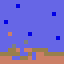 | — | 0 | 13 |
| 14 |  | — | 0 | 14 |
| 15 |  | — | 0 | 15 |
| 16 |  | — | 0 | 16 |
| 17 | 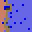 | — | 0 | 17 |
| 18 |  | — | 0 | 18 |
| 19 |  | — | 0 | 19 |
| 20 |  | `LASTRIVEDGE`, `WATER_HIGH` | 0 | 20 |
| 21 |  | `TREEBASE`, `WOODS_LOW` | 0 | 21 |
| 22 |  | — | 0 | 22 |
| 23 |  | — | 0 | 23 |
| 24 |  | — | 0 | 24 |
| 25 |  | — | 0 | 25 |
| 26 |  | — | 0 | 26 |
| 27 |  | — | 0 | 27 |
| 28 |  | — | 0 | 28 |
| 29 |  | — | 0 | 29 |
| 30 |  | — | 0 | 30 |
| 31 |  | — | 0 | 31 |
| 32 |  | — | 1 | 0 |
| 33 |  | — | 1 | 1 |
| 34 |  | — | 1 | 2 |
| 35 |  | — | 1 | 3 |
| 36 |  | `LASTTREE` | 1 | 4 |
| 37 |  | `WOODS` | 1 | 5 |
| 38 |  | `UNUSED_TRASH1` | 1 | 6 |
| 39 |  | `UNUSED_TRASH2`, `WOODS_HIGH` | 1 | 7 |
| 40 |  | `WOODS2` | 1 | 8 |
| 41 | 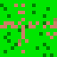 | `WOODS3` | 1 | 9 |
| 42 | 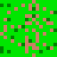 | `WOODS4` | 1 | 10 |
| 43 | 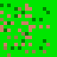 | `WOODS5` | 1 | 11 |
| 44 |  | `RUBBLE` | 1 | 12 |
| 45 |  | — | 1 | 13 |
| 46 |  | — | 1 | 14 |
| 47 |  | `LASTRUBBLE` | 1 | 15 |
| 48 |  | `FLOOD` | 1 | 16 |
| 49 |  | — | 1 | 17 |
| 50 |  | — | 1 | 18 |
| 51 |  | `LASTFLOOD` | 1 | 19 |
| 52 |  | `RADTILE` | 1 | 20 |
| 53 |  | `UNUSED_TRASH3` | 1 | 21 |
| 54 |  | `UNUSED_TRASH4` | 1 | 22 |
| 55 |  | `UNUSED_TRASH5` | 1 | 23 |
| 56 |  | `FIRE`, `FIREBASE` | 1 | 24 |
| 57 |  | — | 1 | 25 |
| 58 |  | — | 1 | 26 |
| 59 |  | — | 1 | 27 |
| 60 |  | — | 1 | 28 |
| 61 |  | — | 1 | 29 |
| 62 |  | — | 1 | 30 |
| 63 |  | `LASTFIRE` | 1 | 31 |
| 64 |  | `HBRIDGE`, `ROADBASE` | 2 | 0 |
| 65 |  | `VBRIDGE` | 2 | 1 |
| 66 |  | `ROADS` | 2 | 2 |
| 67 |  | `ROADS2` | 2 | 3 |
| 68 |  | `ROADS3` | 2 | 4 |
| 69 |  | `ROADS4` | 2 | 5 |
| 70 |  | `ROADS5` | 2 | 6 |
| 71 |  | `ROADS6` | 2 | 7 |
| 72 |  | `ROADS7` | 2 | 8 |
| 73 |  | `ROADS8` | 2 | 9 |
| 74 |  | `ROADS9` | 2 | 10 |
| 75 |  | `ROADS10` | 2 | 11 |
| 76 |  | `INTERSECTION` | 2 | 12 |
| 77 |  | `HROADPOWER` | 2 | 13 |
| 78 |  | `VROADPOWER` | 2 | 14 |
| 79 |  | `BRWH` | 2 | 15 |
| 80 |  | `LTRFBASE` | 2 | 16 |
| 81 |  | — | 2 | 17 |
| 82 |  | — | 2 | 18 |
| 83 |  | — | 2 | 19 |
| 84 |  | — | 2 | 20 |
| 85 |  | — | 2 | 21 |
| 86 |  | — | 2 | 22 |
| 87 |  | — | 2 | 23 |
| 88 |  | — | 2 | 24 |
| 89 |  | — | 2 | 25 |
| 90 |  | — | 2 | 26 |
| 91 |  | — | 2 | 27 |
| 92 |  | — | 2 | 28 |
| 93 |  | — | 2 | 29 |
| 94 |  | — | 2 | 30 |
| 95 |  | `BRWV` | 2 | 31 |
| 96 |  | — | 3 | 0 |
| 97 |  | — | 3 | 1 |
| 98 |  | — | 3 | 2 |
| 99 |  | — | 3 | 3 |
| 100 |  | — | 3 | 4 |
| 101 |  | — | 3 | 5 |
| 102 |  | — | 3 | 6 |
| 103 |  | — | 3 | 7 |
| 104 |  | — | 3 | 8 |
| 105 |  | — | 3 | 9 |
| 106 |  | — | 3 | 10 |
| 107 |  | — | 3 | 11 |
| 108 |  | — | 3 | 12 |
| 109 |  | — | 3 | 13 |
| 110 |  | — | 3 | 14 |
| 111 |  | `BRWXXX1` | 3 | 15 |
| 112 |  | — | 3 | 16 |
| 113 |  | — | 3 | 17 |
| 114 |  | — | 3 | 18 |
| 115 |  | — | 3 | 19 |
| 116 |  | — | 3 | 20 |
| 117 |  | — | 3 | 21 |
| 118 |  | — | 3 | 22 |
| 119 |  | — | 3 | 23 |
| 120 |  | — | 3 | 24 |
| 121 |  | — | 3 | 25 |
| 122 |  | — | 3 | 26 |
| 123 |  | — | 3 | 27 |
| 124 |  | — | 3 | 28 |
| 125 |  | — | 3 | 29 |
| 126 |  | — | 3 | 30 |
| 127 |  | `BRWXXX2` | 3 | 31 |
| 128 |  | — | 4 | 0 |
| 129 |  | — | 4 | 1 |
| 130 |  | — | 4 | 2 |
| 131 |  | — | 4 | 3 |
| 132 |  | — | 4 | 4 |
| 133 |  | — | 4 | 5 |
| 134 |  | — | 4 | 6 |
| 135 |  | — | 4 | 7 |
| 136 |  | — | 4 | 8 |
| 137 |  | — | 4 | 9 |
| 138 |  | — | 4 | 10 |
| 139 |  | — | 4 | 11 |
| 140 |  | — | 4 | 12 |
| 141 |  | — | 4 | 13 |
| 142 |  | — | 4 | 14 |
| 143 |  | `BRWXXX3` | 4 | 15 |
| 144 |  | `HTRFBASE` | 4 | 16 |
| 145 |  | — | 4 | 17 |
| 146 |  | — | 4 | 18 |
| 147 |  | — | 4 | 19 |
| 148 |  | — | 4 | 20 |
| 149 |  | — | 4 | 21 |
| 150 |  | — | 4 | 22 |
| 151 |  | — | 4 | 23 |
| 152 |  | — | 4 | 24 |
| 153 |  | — | 4 | 25 |
| 154 |  | — | 4 | 26 |
| 155 |  | — | 4 | 27 |
| 156 |  | — | 4 | 28 |
| 157 |  | — | 4 | 29 |
| 158 |  | — | 4 | 30 |
| 159 |  | `BRWXXX4` | 4 | 31 |
| 160 |  | — | 5 | 0 |
| 161 |  | — | 5 | 1 |
| 162 |  | — | 5 | 2 |
| 163 |  | — | 5 | 3 |
| 164 |  | — | 5 | 4 |
| 165 |  | — | 5 | 5 |
| 166 |  | — | 5 | 6 |
| 167 |  | — | 5 | 7 |
| 168 |  | — | 5 | 8 |
| 169 |  | — | 5 | 9 |
| 170 |  | — | 5 | 10 |
| 171 |  | — | 5 | 11 |
| 172 |  | — | 5 | 12 |
| 173 |  | — | 5 | 13 |
| 174 |  | — | 5 | 14 |
| 175 |  | `BRWXXX5` | 5 | 15 |
| 176 |  | — | 5 | 16 |
| 177 | 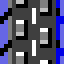 | — | 5 | 17 |
| 178 |  | — | 5 | 18 |
| 179 |  | — | 5 | 19 |
| 180 |  | — | 5 | 20 |
| 181 |  | — | 5 | 21 |
| 182 |  | — | 5 | 22 |
| 183 |  | — | 5 | 23 |
| 184 |  | — | 5 | 24 |
| 185 |  | — | 5 | 25 |
| 186 |  | — | 5 | 26 |
| 187 |  | — | 5 | 27 |
| 188 |  | — | 5 | 28 |
| 189 |  | — | 5 | 29 |
| 190 | 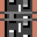 | — | 5 | 30 |
| 191 |  | `BRWXXX6` | 5 | 31 |
| 192 | 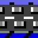 | — | 6 | 0 |
| 193 | 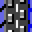 | — | 6 | 1 |
| 194 |  | — | 6 | 2 |
| 195 |  | — | 6 | 3 |
| 196 |  | — | 6 | 4 |
| 197 |  | — | 6 | 5 |
| 198 |  | — | 6 | 6 |
| 199 |  | — | 6 | 7 |
| 200 |  | — | 6 | 8 |
| 201 |  | — | 6 | 9 |
| 202 |  | — | 6 | 10 |
| 203 |  | — | 6 | 11 |
| 204 |  | — | 6 | 12 |
| 205 |  | — | 6 | 13 |
| 206 | 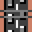 | `LASTROAD` | 6 | 14 |
| 207 |  | `BRWXXX7` | 6 | 15 |
| 208 |  | `HPOWER`, `POWERBASE` | 6 | 16 |
| 209 |  | `VPOWER` | 6 | 17 |
| 210 |  | `LHPOWER` | 6 | 18 |
| 211 | 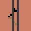 | `LVPOWER` | 6 | 19 |
| 212 |  | `LVPOWER2` | 6 | 20 |
| 213 |  | `LVPOWER3` | 6 | 21 |
| 214 |  | `LVPOWER4` | 6 | 22 |
| 215 |  | `LVPOWER5` | 6 | 23 |
| 216 |  | `LVPOWER6` | 6 | 24 |
| 217 |  | `LVPOWER7` | 6 | 25 |
| 218 | 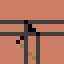 | `LVPOWER8` | 6 | 26 |
| 219 |  | `LVPOWER9` | 6 | 27 |
| 220 |  | `LVPOWER10` | 6 | 28 |
| 221 |  | `RAILHPOWERV` | 6 | 29 |
| 222 |  | `RAILVPOWERH`, `LASTPOWER` | 6 | 30 |
| 223 |  | `UNUSED_TRASH6` | 6 | 31 |
| 224 |  | `HRAIL`, `RAILBASE` | 7 | 0 |
| 225 |  | `VRAIL` | 7 | 1 |
| 226 |  | `LHRAIL` | 7 | 2 |
| 227 | 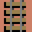 | `LVRAIL` | 7 | 3 |
| 228 | 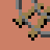 | `LVRAIL2` | 7 | 4 |
| 229 |  | `LVRAIL3` | 7 | 5 |
| 230 |  | `LVRAIL4` | 7 | 6 |
| 231 | 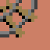 | `LVRAIL5` | 7 | 7 |
| 232 |  | `LVRAIL6` | 7 | 8 |
| 233 |  | `LVRAIL7` | 7 | 9 |
| 234 |  | `LVRAIL8` | 7 | 10 |
| 235 |  | `LVRAIL9` | 7 | 11 |
| 236 |  | `LVRAIL10` | 7 | 12 |
| 237 |  | `HRAILROAD` | 7 | 13 |
| 238 |  | `VRAILROAD`, `LASTRAIL` | 7 | 14 |
| 239 |  | `ROADVPOWERH` | 7 | 15 |
| 240 |  | `RESBASE` | 7 | 16 |
| 241 |  | — | 7 | 17 |
| 242 |  | — | 7 | 18 |
| 243 |  | — | 7 | 19 |
| 244 |  | `FREEZ` | 7 | 20 |
| 245 |  | — | 7 | 21 |
| 246 |  | — | 7 | 22 |
| 247 |  | — | 7 | 23 |
| 248 |  | — | 7 | 24 |
| 249 |  | `HOUSE`, `LHTHR` | 7 | 25 |
| 250 |  | — | 7 | 26 |
| 251 |  | — | 7 | 27 |
| 252 | 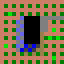 | — | 7 | 28 |
| 253 |  | — | 7 | 29 |
| 254 |  | — | 7 | 30 |
| 255 |  | — | 7 | 31 |
| 256 |  | — | 8 | 0 |
| 257 |  | — | 8 | 1 |
| 258 |  | — | 8 | 2 |
| 259 |  | — | 8 | 3 |
| 260 |  | `HHTHR` | 8 | 4 |
| 261 |  | — | 8 | 5 |
| 262 |  | — | 8 | 6 |
| 263 |  | — | 8 | 7 |
| 264 |  | — | 8 | 8 |
| 265 |  | `RZB` | 8 | 9 |
| 266 |  | — | 8 | 10 |
| 267 |  | — | 8 | 11 |
| 268 |  | — | 8 | 12 |
| 269 |  | — | 8 | 13 |
| 270 |  | — | 8 | 14 |
| 271 |  | — | 8 | 15 |
| 272 |  | — | 8 | 16 |
| 273 |  | — | 8 | 17 |
| 274 |  | — | 8 | 18 |
| 275 |  | — | 8 | 19 |
| 276 |  | — | 8 | 20 |
| 277 |  | — | 8 | 21 |
| 278 |  | — | 8 | 22 |
| 279 |  | — | 8 | 23 |
| 280 | 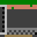 | — | 8 | 24 |
| 281 |  | — | 8 | 25 |
| 282 |  | — | 8 | 26 |
| 283 |  | — | 8 | 27 |
| 284 |  | — | 8 | 28 |
| 285 |  | — | 8 | 29 |
| 286 | 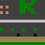 | — | 8 | 30 |
| 287 |  | — | 8 | 31 |
| 288 |  | — | 9 | 0 |
| 289 |  | — | 9 | 1 |
| 290 |  | — | 9 | 2 |
| 291 | 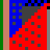 | — | 9 | 3 |
| 292 |  | — | 9 | 4 |
| 293 |  | — | 9 | 5 |
| 294 |  | — | 9 | 6 |
| 295 | 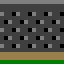 | — | 9 | 7 |
| 296 |  | — | 9 | 8 |
| 297 |  | — | 9 | 9 |
| 298 |  | — | 9 | 10 |
| 299 |  | — | 9 | 11 |
| 300 |  | — | 9 | 12 |
| 301 |  | — | 9 | 13 |
| 302 |  | — | 9 | 14 |
| 303 |  | — | 9 | 15 |
| 304 |  | — | 9 | 16 |
| 305 | 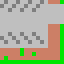 | — | 9 | 17 |
| 306 |  | — | 9 | 18 |
| 307 |  | — | 9 | 19 |
| 308 |  | — | 9 | 20 |
| 309 |  | — | 9 | 21 |
| 310 | 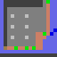 | — | 9 | 22 |
| 311 |  | — | 9 | 23 |
| 312 |  | — | 9 | 24 |
| 313 | 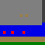 | — | 9 | 25 |
| 314 | 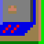 | — | 9 | 26 |
| 315 |  | — | 9 | 27 |
| 316 |  | — | 9 | 28 |
| 317 |  | — | 9 | 29 |
| 318 | 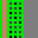 | — | 9 | 30 |
| 319 |  | — | 9 | 31 |
| 320 |  | — | 10 | 0 |
| 321 |  | — | 10 | 1 |
| 322 | 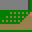 | — | 10 | 2 |
| 323 |  | — | 10 | 3 |
| 324 | 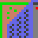 | — | 10 | 4 |
| 325 |  | — | 10 | 5 |
| 326 |  | — | 10 | 6 |
| 327 | 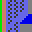 | — | 10 | 7 |
| 328 |  | — | 10 | 8 |
| 329 |  | — | 10 | 9 |
| 330 |  | — | 10 | 10 |
| 331 | 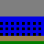 | — | 10 | 11 |
| 332 | 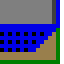 | — | 10 | 12 |
| 333 |  | — | 10 | 13 |
| 334 |  | — | 10 | 14 |
| 335 |  | — | 10 | 15 |
| 336 |  | — | 10 | 16 |
| 337 |  | — | 10 | 17 |
| 338 |  | — | 10 | 18 |
| 339 |  | — | 10 | 19 |
| 340 |  | — | 10 | 20 |
| 341 |  | — | 10 | 21 |
| 342 |  | — | 10 | 22 |
| 343 |  | — | 10 | 23 |
| 344 |  | — | 10 | 24 |
| 345 |  | — | 10 | 25 |
| 346 |  | — | 10 | 26 |
| 347 |  | — | 10 | 27 |
| 348 |  | — | 10 | 28 |
| 349 |  | — | 10 | 29 |
| 350 |  | — | 10 | 30 |
| 351 |  | — | 10 | 31 |
| 352 |  | — | 11 | 0 |
| 353 |  | — | 11 | 1 |
| 354 |  | — | 11 | 2 |
| 355 |  | — | 11 | 3 |
| 356 |  | — | 11 | 4 |
| 357 | 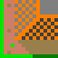 | — | 11 | 5 |
| 358 |  | — | 11 | 6 |
| 359 |  | — | 11 | 7 |
| 360 |  | — | 11 | 8 |
| 361 |  | — | 11 | 9 |
| 362 |  | — | 11 | 10 |
| 363 |  | — | 11 | 11 |
| 364 |  | — | 11 | 12 |
| 365 |  | — | 11 | 13 |
| 366 |  | — | 11 | 14 |
| 367 |  | — | 11 | 15 |
| 368 |  | — | 11 | 16 |
| 369 |  | — | 11 | 17 |
| 370 |  | — | 11 | 18 |
| 371 |  | — | 11 | 19 |
| 372 |  | — | 11 | 20 |
| 373 |  | — | 11 | 21 |
| 374 |  | — | 11 | 22 |
| 375 |  | — | 11 | 23 |
| 376 |  | — | 11 | 24 |
| 377 |  | — | 11 | 25 |
| 378 |  | — | 11 | 26 |
| 379 |  | — | 11 | 27 |
| 380 |  | — | 11 | 28 |
| 381 |  | — | 11 | 29 |
| 382 |  | — | 11 | 30 |
| 383 |  | — | 11 | 31 |
| 384 |  | — | 12 | 0 |
| 385 |  | — | 12 | 1 |
| 386 |  | — | 12 | 2 |
| 387 |  | — | 12 | 3 |
| 388 |  | — | 12 | 4 |
| 389 | 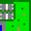 | — | 12 | 5 |
| 390 |  | — | 12 | 6 |
| 391 |  | — | 12 | 7 |
| 392 |  | — | 12 | 8 |
| 393 |  | — | 12 | 9 |
| 394 |  | — | 12 | 10 |
| 395 |  | — | 12 | 11 |
| 396 |  | — | 12 | 12 |
| 397 |  | — | 12 | 13 |
| 398 |  | — | 12 | 14 |
| 399 |  | — | 12 | 15 |
| 400 |  | — | 12 | 16 |
| 401 |  | — | 12 | 17 |
| 402 |  | — | 12 | 18 |
| 403 |  | — | 12 | 19 |
| 404 |  | — | 12 | 20 |
| 405 |  | `HOSPITALBASE` | 12 | 21 |
| 406 |  | — | 12 | 22 |
| 407 |  | — | 12 | 23 |
| 408 |  | — | 12 | 24 |
| 409 |  | `HOSPITAL` | 12 | 25 |
| 410 |  | — | 12 | 26 |
| 411 |  | — | 12 | 27 |
| 412 |  | — | 12 | 28 |
| 413 |  | — | 12 | 29 |
| 414 |  | `CHURCHBASE`, `CHURCH0BASE` | 12 | 30 |
| 415 |  | — | 12 | 31 |
| 416 |  | — | 13 | 0 |
| 417 |  | — | 13 | 1 |
| 418 |  | `CHURCH`, `CHURCH0` | 13 | 2 |
| 419 |  | — | 13 | 3 |
| 420 |  | — | 13 | 4 |
| 421 |  | — | 13 | 5 |
| 422 |  | — | 13 | 6 |
| 423 |  | `COMBASE` | 13 | 7 |
| 424 |  | — | 13 | 8 |
| 425 |  | — | 13 | 9 |
| 426 |  | — | 13 | 10 |
| 427 |  | `COMCLR` | 13 | 11 |
| 428 |  | — | 13 | 12 |
| 429 |  | — | 13 | 13 |
| 430 |  | — | 13 | 14 |
| 431 |  | — | 13 | 15 |
| 432 |  | — | 13 | 16 |
| 433 |  | — | 13 | 17 |
| 434 |  | — | 13 | 18 |
| 435 |  | — | 13 | 19 |
| 436 |  | `CZB` | 13 | 20 |
| 437 |  | — | 13 | 21 |
| 438 |  | — | 13 | 22 |
| 439 | 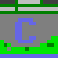 | — | 13 | 23 |
| 440 |  | — | 13 | 24 |
| 441 | 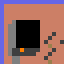 | — | 13 | 25 |
| 442 |  | — | 13 | 26 |
| 443 |  | — | 13 | 27 |
| 444 | 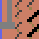 | — | 13 | 28 |
| 445 |  | — | 13 | 29 |
| 446 |  | — | 13 | 30 |
| 447 |  | — | 13 | 31 |
| 448 |  | — | 14 | 0 |
| 449 | 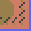 | — | 14 | 1 |
| 450 | 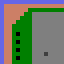 | — | 14 | 2 |
| 451 |  | — | 14 | 3 |
| 452 |  | — | 14 | 4 |
| 453 |  | — | 14 | 5 |
| 454 |  | — | 14 | 6 |
| 455 |  | — | 14 | 7 |
| 456 |  | — | 14 | 8 |
| 457 |  | — | 14 | 9 |
| 458 |  | — | 14 | 10 |
| 459 |  | — | 14 | 11 |
| 460 |  | — | 14 | 12 |
| 461 |  | — | 14 | 13 |
| 462 |  | — | 14 | 14 |
| 463 |  | — | 14 | 15 |
| 464 |  | — | 14 | 16 |
| 465 |  | — | 14 | 17 |
| 466 |  | — | 14 | 18 |
| 467 |  | — | 14 | 19 |
| 468 | 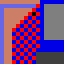 | — | 14 | 20 |
| 469 |  | — | 14 | 21 |
| 470 |  | — | 14 | 22 |
| 471 | 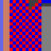 | — | 14 | 23 |
| 472 |  | — | 14 | 24 |
| 473 |  | — | 14 | 25 |
| 474 | 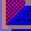 | — | 14 | 26 |
| 475 |  | — | 14 | 27 |
| 476 |  | — | 14 | 28 |
| 477 |  | — | 14 | 29 |
| 478 |  | — | 14 | 30 |
| 479 |  | — | 14 | 31 |
| 480 |  | — | 15 | 0 |
| 481 |  | — | 15 | 1 |
| 482 | 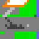 | — | 15 | 2 |
| 483 |  | — | 15 | 3 |
| 484 |  | — | 15 | 4 |
| 485 |  | — | 15 | 5 |
| 486 | 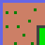 | — | 15 | 6 |
| 487 |  | — | 15 | 7 |
| 488 | 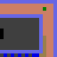 | — | 15 | 8 |
| 489 |  | — | 15 | 9 |
| 490 |  | — | 15 | 10 |
| 491 |  | — | 15 | 11 |
| 492 |  | — | 15 | 12 |
| 493 |  | — | 15 | 13 |
| 494 |  | — | 15 | 14 |
| 495 |  | — | 15 | 15 |
| 496 |  | — | 15 | 16 |
| 497 |  | — | 15 | 17 |
| 498 | 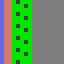 | — | 15 | 18 |
| 499 |  | — | 15 | 19 |
| 500 |  | — | 15 | 20 |
| 501 |  | — | 15 | 21 |
| 502 |  | — | 15 | 22 |
| 503 |  | — | 15 | 23 |
| 504 | 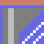 | — | 15 | 24 |
| 505 |  | — | 15 | 25 |
| 506 |  | — | 15 | 26 |
| 507 |  | — | 15 | 27 |
| 508 |  | — | 15 | 28 |
| 509 |  | — | 15 | 29 |
| 510 | 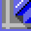 | — | 15 | 30 |
| 511 | 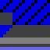 | — | 15 | 31 |
| 512 | 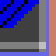 | — | 16 | 0 |
| 513 |  | — | 16 | 1 |
| 514 |  | — | 16 | 2 |
| 515 |  | — | 16 | 3 |
| 516 |  | — | 16 | 4 |
| 517 |  | — | 16 | 5 |
| 518 |  | — | 16 | 6 |
| 519 |  | — | 16 | 7 |
| 520 |  | — | 16 | 8 |
| 521 |  | — | 16 | 9 |
| 522 |  | — | 16 | 10 |
| 523 |  | — | 16 | 11 |
| 524 |  | — | 16 | 12 |
| 525 |  | — | 16 | 13 |
| 526 |  | — | 16 | 14 |
| 527 |  | — | 16 | 15 |
| 528 |  | — | 16 | 16 |
| 529 |  | — | 16 | 17 |
| 530 |  | — | 16 | 18 |
| 531 |  | — | 16 | 19 |
| 532 |  | — | 16 | 20 |
| 533 |  | — | 16 | 21 |
| 534 |  | — | 16 | 22 |
| 535 |  | — | 16 | 23 |
| 536 |  | — | 16 | 24 |
| 537 |  | — | 16 | 25 |
| 538 |  | — | 16 | 26 |
| 539 | 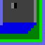 | — | 16 | 27 |
| 540 | 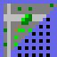 | — | 16 | 28 |
| 541 |  | — | 16 | 29 |
| 542 |  | — | 16 | 30 |
| 543 |  | — | 16 | 31 |
| 544 |  | — | 17 | 0 |
| 545 |  | — | 17 | 1 |
| 546 |  | — | 17 | 2 |
| 547 |  | — | 17 | 3 |
| 548 |  | — | 17 | 4 |
| 549 |  | — | 17 | 5 |
| 550 |  | — | 17 | 6 |
| 551 |  | — | 17 | 7 |
| 552 |  | — | 17 | 8 |
| 553 |  | — | 17 | 9 |
| 554 |  | — | 17 | 10 |
| 555 |  | — | 17 | 11 |
| 556 |  | — | 17 | 12 |
| 557 |  | — | 17 | 13 |
| 558 |  | — | 17 | 14 |
| 559 |  | — | 17 | 15 |
| 560 |  | — | 17 | 16 |
| 561 |  | — | 17 | 17 |
| 562 |  | — | 17 | 18 |
| 563 |  | — | 17 | 19 |
| 564 |  | — | 17 | 20 |
| 565 |  | — | 17 | 21 |
| 566 |  | — | 17 | 22 |
| 567 |  | — | 17 | 23 |
| 568 |  | — | 17 | 24 |
| 569 |  | — | 17 | 25 |
| 570 |  | — | 17 | 26 |
| 571 |  | — | 17 | 27 |
| 572 |  | — | 17 | 28 |
| 573 |  | — | 17 | 29 |
| 574 |  | — | 17 | 30 |
| 575 |  | — | 17 | 31 |
| 576 |  | — | 18 | 0 |
| 577 |  | — | 18 | 1 |
| 578 |  | — | 18 | 2 |
| 579 |  | — | 18 | 3 |
| 580 |  | — | 18 | 4 |
| 581 |  | — | 18 | 5 |
| 582 |  | — | 18 | 6 |
| 583 |  | — | 18 | 7 |
| 584 |  | — | 18 | 8 |
| 585 |  | — | 18 | 9 |
| 586 |  | — | 18 | 10 |
| 587 |  | — | 18 | 11 |
| 588 |  | — | 18 | 12 |
| 589 |  | — | 18 | 13 |
| 590 |  | — | 18 | 14 |
| 591 |  | — | 18 | 15 |
| 592 |  | — | 18 | 16 |
| 593 |  | — | 18 | 17 |
| 594 |  | — | 18 | 18 |
| 595 |  | — | 18 | 19 |
| 596 |  | — | 18 | 20 |
| 597 |  | — | 18 | 21 |
| 598 |  | — | 18 | 22 |
| 599 |  | — | 18 | 23 |
| 600 |  | — | 18 | 24 |
| 601 |  | — | 18 | 25 |
| 602 |  | — | 18 | 26 |
| 603 |  | — | 18 | 27 |
| 604 |  | — | 18 | 28 |
| 605 |  | — | 18 | 29 |
| 606 |  | — | 18 | 30 |
| 607 |  | — | 18 | 31 |
| 608 |  | — | 19 | 0 |
| 609 |  | `COMLAST` | 19 | 1 |
| 610 |  | — | 19 | 2 |
| 611 |  | — | 19 | 3 |
| 612 |  | `INDBASE` | 19 | 4 |
| 613 |  | — | 19 | 5 |
| 614 |  | — | 19 | 6 |
| 615 |  | — | 19 | 7 |
| 616 |  | `INDCLR` | 19 | 8 |
| 617 |  | — | 19 | 9 |
| 618 |  | — | 19 | 10 |
| 619 |  | — | 19 | 11 |
| 620 |  | `LASTIND` | 19 | 12 |
| 621 |  | `IND1` | 19 | 13 |
| 622 |  | — | 19 | 14 |
| 623 |  | — | 19 | 15 |
| 624 |  | — | 19 | 16 |
| 625 |  | `IZB` | 19 | 17 |
| 626 |  | — | 19 | 18 |
| 627 |  | — | 19 | 19 |
| 628 |  | — | 19 | 20 |
| 629 |  | — | 19 | 21 |
| 630 |  | — | 19 | 22 |
| 631 |  | — | 19 | 23 |
| 632 |  | — | 19 | 24 |
| 633 |  | — | 19 | 25 |
| 634 |  | — | 19 | 26 |
| 635 |  | — | 19 | 27 |
| 636 |  | — | 19 | 28 |
| 637 |  | — | 19 | 29 |
| 638 |  | — | 19 | 30 |
| 639 |  | — | 19 | 31 |
| 640 |  | — | 20 | 0 |
| 641 |  | `IND2` | 20 | 1 |
| 642 |  | — | 20 | 2 |
| 643 |  | — | 20 | 3 |
| 644 |  | `IND3` | 20 | 4 |
| 645 |  | — | 20 | 5 |
| 646 |  | — | 20 | 6 |
| 647 |  | — | 20 | 7 |
| 648 |  | — | 20 | 8 |
| 649 |  | `IND4` | 20 | 9 |
| 650 |  | `IND5` | 20 | 10 |
| 651 |  | — | 20 | 11 |
| 652 |  | — | 20 | 12 |
| 653 |  | — | 20 | 13 |
| 654 |  | — | 20 | 14 |
| 655 |  | — | 20 | 15 |
| 656 |  | — | 20 | 16 |
| 657 |  | — | 20 | 17 |
| 658 |  | — | 20 | 18 |
| 659 |  | — | 20 | 19 |
| 660 |  | — | 20 | 20 |
| 661 |  | — | 20 | 21 |
| 662 |  | — | 20 | 22 |
| 663 |  | — | 20 | 23 |
| 664 |  | — | 20 | 24 |
| 665 |  | — | 20 | 25 |
| 666 |  | — | 20 | 26 |
| 667 |  | — | 20 | 27 |
| 668 |  | — | 20 | 28 |
| 669 |  | — | 20 | 29 |
| 670 |  | — | 20 | 30 |
| 671 |  | — | 20 | 31 |
| 672 |  | — | 21 | 0 |
| 673 |  | — | 21 | 1 |
| 674 |  | — | 21 | 2 |
| 675 |  | — | 21 | 3 |
| 676 |  | `IND6` | 21 | 4 |
| 677 |  | `IND7` | 21 | 5 |
| 678 |  | — | 21 | 6 |
| 679 |  | — | 21 | 7 |
| 680 |  | — | 21 | 8 |
| 681 |  | — | 21 | 9 |
| 682 |  | — | 21 | 10 |
| 683 |  | — | 21 | 11 |
| 684 |  | — | 21 | 12 |
| 685 |  | — | 21 | 13 |
| 686 |  | `IND8` | 21 | 14 |
| 687 |  | — | 21 | 15 |
| 688 |  | — | 21 | 16 |
| 689 |  | `IND9` | 21 | 17 |
| 690 |  | — | 21 | 18 |
| 691 |  | — | 21 | 19 |
| 692 |  | — | 21 | 20 |
| 693 |  | `PORTBASE` | 21 | 21 |
| 694 |  | — | 21 | 22 |
| 695 |  | — | 21 | 23 |
| 696 |  | — | 21 | 24 |
| 697 |  | — | 21 | 25 |
| 698 |  | `PORT` | 21 | 26 |
| 699 |  | — | 21 | 27 |
| 700 |  | — | 21 | 28 |
| 701 |  | — | 21 | 29 |
| 702 |  | — | 21 | 30 |
| 703 |  | — | 21 | 31 |
| 704 |  | — | 22 | 0 |
| 705 |  | — | 22 | 1 |
| 706 |  | — | 22 | 2 |
| 707 |  | — | 22 | 3 |
| 708 |  | `LASTPORT` | 22 | 4 |
| 709 |  | `AIRPORTBASE` | 22 | 5 |
| 710 |  | — | 22 | 6 |
| 711 |  | `RADAR` | 22 | 7 |
| 712 |  | — | 22 | 8 |
| 713 |  | — | 22 | 9 |
| 714 |  | — | 22 | 10 |
| 715 |  | — | 22 | 11 |
| 716 |  | `AIRPORT` | 22 | 12 |
| 717 |  | — | 22 | 13 |
| 718 |  | — | 22 | 14 |
| 719 |  | — | 22 | 15 |
| 720 |  | — | 22 | 16 |
| 721 |  | — | 22 | 17 |
| 722 |  | — | 22 | 18 |
| 723 |  | — | 22 | 19 |
| 724 |  | — | 22 | 20 |
| 725 |  | — | 22 | 21 |
| 726 |  | — | 22 | 22 |
| 727 |  | — | 22 | 23 |
| 728 |  | — | 22 | 24 |
| 729 |  | — | 22 | 25 |
| 730 |  | — | 22 | 26 |
| 731 |  | — | 22 | 27 |
| 732 |  | — | 22 | 28 |
| 733 |  | — | 22 | 29 |
| 734 |  | — | 22 | 30 |
| 735 |  | — | 22 | 31 |
| 736 |  | — | 23 | 0 |
| 737 |  | — | 23 | 1 |
| 738 |  | — | 23 | 2 |
| 739 |  | — | 23 | 3 |
| 740 |  | — | 23 | 4 |
| 741 |  | — | 23 | 5 |
| 742 |  | — | 23 | 6 |
| 743 |  | — | 23 | 7 |
| 744 |  | — | 23 | 8 |
| 745 |  | `COALBASE` | 23 | 9 |
| 746 |  | — | 23 | 10 |
| 747 |  | — | 23 | 11 |
| 748 |  | — | 23 | 12 |
| 749 |  | — | 23 | 13 |
| 750 |  | `POWERPLANT` | 23 | 14 |
| 751 |  | — | 23 | 15 |
| 752 |  | — | 23 | 16 |
| 753 |  | — | 23 | 17 |
| 754 |  | — | 23 | 18 |
| 755 |  | — | 23 | 19 |
| 756 |  | — | 23 | 20 |
| 757 |  | — | 23 | 21 |
| 758 |  | — | 23 | 22 |
| 759 |  | — | 23 | 23 |
| 760 |  | `LASTPOWERPLANT` | 23 | 24 |
| 761 |  | `FIRESTBASE` | 23 | 25 |
| 762 |  | — | 23 | 26 |
| 763 |  | — | 23 | 27 |
| 764 |  | — | 23 | 28 |
| 765 |  | `FIRESTATION` | 23 | 29 |
| 766 |  | — | 23 | 30 |
| 767 |  | — | 23 | 31 |
| 768 |  | — | 24 | 0 |
| 769 |  | — | 24 | 1 |
| 770 |  | `POLICESTBASE` | 24 | 2 |
| 771 |  | — | 24 | 3 |
| 772 |  | — | 24 | 4 |
| 773 |  | — | 24 | 5 |
| 774 |  | `POLICESTATION` | 24 | 6 |
| 775 |  | — | 24 | 7 |
| 776 |  | — | 24 | 8 |
| 777 |  | — | 24 | 9 |
| 778 |  | — | 24 | 10 |
| 779 |  | `STADIUMBASE` | 24 | 11 |
| 780 |  | — | 24 | 12 |
| 781 |  | — | 24 | 13 |
| 782 |  | — | 24 | 14 |
| 783 |  | — | 24 | 15 |
| 784 |  | `STADIUM` | 24 | 16 |
| 785 |  | — | 24 | 17 |
| 786 |  | — | 24 | 18 |
| 787 |  | — | 24 | 19 |
| 788 |  | — | 24 | 20 |
| 789 |  | — | 24 | 21 |
| 790 |  | — | 24 | 22 |
| 791 |  | — | 24 | 23 |
| 792 |  | — | 24 | 24 |
| 793 |  | — | 24 | 25 |
| 794 |  | — | 24 | 26 |
| 795 |  | — | 24 | 27 |
| 796 |  | — | 24 | 28 |
| 797 |  | — | 24 | 29 |
| 798 |  | — | 24 | 30 |
| 799 |  | — | 24 | 31 |
| 800 |  | `FULLSTADIUM` | 25 | 0 |
| 801 |  | — | 25 | 1 |
| 802 |  | — | 25 | 2 |
| 803 |  | — | 25 | 3 |
| 804 |  | — | 25 | 4 |
| 805 |  | — | 25 | 5 |
| 806 |  | — | 25 | 6 |
| 807 |  | — | 25 | 7 |
| 808 |  | — | 25 | 8 |
| 809 |  | — | 25 | 9 |
| 810 |  | — | 25 | 10 |
| 811 |  | `NUCLEARBASE` | 25 | 11 |
| 812 |  | — | 25 | 12 |
| 813 |  | — | 25 | 13 |
| 814 |  | — | 25 | 14 |
| 815 |  | — | 25 | 15 |
| 816 |  | `NUCLEAR` | 25 | 16 |
| 817 |  | — | 25 | 17 |
| 818 |  | — | 25 | 18 |
| 819 |  | — | 25 | 19 |
| 820 |  | — | 25 | 20 |
| 821 |  | — | 25 | 21 |
| 822 |  | — | 25 | 22 |
| 823 |  | — | 25 | 23 |
| 824 |  | — | 25 | 24 |
| 825 |  | — | 25 | 25 |
| 826 |  | `LASTZONE` | 25 | 26 |
| 827 |  | `LIGHTNINGBOLT` | 25 | 27 |
| 828 |  | `HBRDG0` | 25 | 28 |
| 829 |  | `HBRDG1` | 25 | 29 |
| 830 |  | `HBRDG2` | 25 | 30 |
| 831 |  | `HBRDG3` | 25 | 31 |
| 832 |  | `HBRDG_END`, `RADAR0` | 26 | 0 |
| 833 |  | `RADAR1` | 26 | 1 |
| 834 |  | `RADAR2` | 26 | 2 |
| 835 |  | `RADAR3` | 26 | 3 |
| 836 |  | `RADAR4` | 26 | 4 |
| 837 |  | `RADAR5` | 26 | 5 |
| 838 |  | `RADAR6` | 26 | 6 |
| 839 |  | `RADAR7` | 26 | 7 |
| 840 |  | `FOUNTAIN` | 26 | 8 |
| 841 |  | — | 26 | 9 |
| 842 |  | — | 26 | 10 |
| 843 |  | — | 26 | 11 |
| 844 |  | `INDBASE2`, `TELEBASE` | 26 | 12 |
| 845 |  | — | 26 | 13 |
| 846 |  | — | 26 | 14 |
| 847 |  | — | 26 | 15 |
| 848 |  | — | 26 | 16 |
| 849 |  | — | 26 | 17 |
| 850 |  | — | 26 | 18 |
| 851 |  | `TELELAST` | 26 | 19 |
| 852 |  | `SMOKEBASE` | 26 | 20 |
| 853 |  | — | 26 | 21 |
| 854 |  | — | 26 | 22 |
| 855 |  | — | 26 | 23 |
| 856 |  | — | 26 | 24 |
| 857 |  | — | 26 | 25 |
| 858 |  | — | 26 | 26 |
| 859 |  | — | 26 | 27 |
| 860 |  | `TINYEXP` | 26 | 28 |
| 861 |  | — | 26 | 29 |
| 862 |  | — | 26 | 30 |
| 863 |  | — | 26 | 31 |
| 864 |  | `SOMETINYEXP` | 27 | 0 |
| 865 |  | — | 27 | 1 |
| 866 |  | — | 27 | 2 |
| 867 |  | `LASTTINYEXP` | 27 | 3 |
| 868 |  | — | 27 | 4 |
| 869 |  | — | 27 | 5 |
| 870 |  | — | 27 | 6 |
| 871 |  | — | 27 | 7 |
| 872 |  | — | 27 | 8 |
| 873 |  | — | 27 | 9 |
| 874 |  | — | 27 | 10 |
| 875 |  | — | 27 | 11 |
| 876 |  | — | 27 | 12 |
| 877 |  | — | 27 | 13 |
| 878 |  | — | 27 | 14 |
| 879 |  | — | 27 | 15 |
| 880 |  | — | 27 | 16 |
| 881 |  | — | 27 | 17 |
| 882 |  | — | 27 | 18 |
| 883 |  | `TINYEXPLAST` | 27 | 19 |
| 884 |  | — | 27 | 20 |
| 885 |  | — | 27 | 21 |
| 886 |  | — | 27 | 22 |
| 887 |  | — | 27 | 23 |
| 888 |  | — | 27 | 24 |
| 889 |  | — | 27 | 25 |
| 890 |  | — | 27 | 26 |
| 891 |  | — | 27 | 27 |
| 892 |  | — | 27 | 28 |
| 893 |  | — | 27 | 29 |
| 894 |  | — | 27 | 30 |
| 895 |  | — | 27 | 31 |
| 896 |  | — | 28 | 0 |
| 897 |  | — | 28 | 1 |
| 898 |  | — | 28 | 2 |
| 899 |  | — | 28 | 3 |
| 900 |  | — | 28 | 4 |
| 901 |  | — | 28 | 5 |
| 902 |  | — | 28 | 6 |
| 903 |  | — | 28 | 7 |
| 904 |  | — | 28 | 8 |
| 905 |  | — | 28 | 9 |
| 906 |  | — | 28 | 10 |
| 907 |  | — | 28 | 11 |
| 908 |  | — | 28 | 12 |
| 909 |  | — | 28 | 13 |
| 910 |  | — | 28 | 14 |
| 911 |  | — | 28 | 15 |
| 912 |  | — | 28 | 16 |
| 913 |  | — | 28 | 17 |
| 914 |  | — | 28 | 18 |
| 915 |  | — | 28 | 19 |
| 916 |  | `COALSMOKE1` | 28 | 20 |
| 917 |  | — | 28 | 21 |
| 918 |  | — | 28 | 22 |
| 919 |  | — | 28 | 23 |
| 920 |  | `COALSMOKE2` | 28 | 24 |
| 921 |  | — | 28 | 25 |
| 922 |  | — | 28 | 26 |
| 923 |  | — | 28 | 27 |
| 924 |  | `COALSMOKE3` | 28 | 28 |
| 925 |  | — | 28 | 29 |
| 926 |  | — | 28 | 30 |
| 927 |  | — | 28 | 31 |
| 928 |  | `COALSMOKE4` | 29 | 0 |
| 929 |  | — | 29 | 1 |
| 930 |  | — | 29 | 2 |
| 931 |  | — | 29 | 3 |
| 932 |  | `FOOTBALLGAME1` | 29 | 4 |
| 933 |  | — | 29 | 5 |
| 934 |  | — | 29 | 6 |
| 935 |  | — | 29 | 7 |
| 936 |  | — | 29 | 8 |
| 937 |  | — | 29 | 9 |
| 938 |  | — | 29 | 10 |
| 939 |  | — | 29 | 11 |
| 940 |  | `FOOTBALLGAME2` | 29 | 12 |
| 941 |  | — | 29 | 13 |
| 942 |  | — | 29 | 14 |
| 943 |  | — | 29 | 15 |
| 944 |  | — | 29 | 16 |
| 945 |  | — | 29 | 17 |
| 946 |  | — | 29 | 18 |
| 947 |  | — | 29 | 19 |
| 948 |  | `VBRDG0` | 29 | 20 |
| 949 |  | `VBRDG1` | 29 | 21 |
| 950 |  | `VBRDG2` | 29 | 22 |
| 951 |  | `VBRDG3` | 29 | 23 |
| 952 |  | `NUKESWIRL1` | 29 | 24 |
| 953 |  | `NUKESWIRL2` | 29 | 25 |
| 954 |  | `NUKESWIRL3` | 29 | 26 |
| 955 |  | `NUKESWIRL4` | 29 | 27 |
| 956 |  | `CHURCH1BASE` | 29 | 28 |
| 957 |  | — | 29 | 29 |
| 958 |  | — | 29 | 30 |
| 959 |  | — | 29 | 31 |
| 960 |  | `CHURCH1` | 30 | 0 |
| 961 |  | — | 30 | 1 |
| 962 |  | — | 30 | 2 |
| 963 |  | — | 30 | 3 |
| 964 |  | — | 30 | 4 |
| 965 |  | `CHURCH2BASE` | 30 | 5 |
| 966 |  | — | 30 | 6 |
| 967 |  | — | 30 | 7 |
| 968 |  | — | 30 | 8 |
| 969 |  | `CHURCH2` | 30 | 9 |
| 970 |  | — | 30 | 10 |
| 971 |  | — | 30 | 11 |
| 972 |  | — | 30 | 12 |
| 973 |  | — | 30 | 13 |
| 974 |  | `CHURCH3BASE` | 30 | 14 |
| 975 |  | — | 30 | 15 |
| 976 |  | — | 30 | 16 |
| 977 |  | — | 30 | 17 |
| 978 |  | `CHURCH3` | 30 | 18 |
| 979 |  | — | 30 | 19 |
| 980 |  | — | 30 | 20 |
| 981 |  | — | 30 | 21 |
| 982 |  | — | 30 | 22 |
| 983 |  | `CHURCH4BASE` | 30 | 23 |
| 984 |  | — | 30 | 24 |
| 985 |  | — | 30 | 25 |
| 986 |  | — | 30 | 26 |
| 987 |  | `CHURCH4` | 30 | 27 |
| 988 |  | — | 30 | 28 |
| 989 |  | — | 30 | 29 |
| 990 |  | — | 30 | 30 |
| 991 |  | — | 30 | 31 |
| 992 |  | `CHURCH5BASE` | 31 | 0 |
| 993 |  | — | 31 | 1 |
| 994 |  | — | 31 | 2 |
| 995 |  | — | 31 | 3 |
| 996 |  | `CHURCH5` | 31 | 4 |
| 997 |  | — | 31 | 5 |
| 998 |  | — | 31 | 6 |
| 999 |  | — | 31 | 7 |
| 1000 |  | — | 31 | 8 |
| 1001 |  | `CHURCH6BASE` | 31 | 9 |
| 1002 |  | — | 31 | 10 |
| 1003 |  | — | 31 | 11 |
| 1004 |  | — | 31 | 12 |
| 1005 |  | `CHURCH6` | 31 | 13 |
| 1006 |  | — | 31 | 14 |
| 1007 |  | — | 31 | 15 |
| 1008 |  | — | 31 | 16 |
| 1009 |  | — | 31 | 17 |
| 1010 |  | `CHURCH7BASE` | 31 | 18 |
| 1011 |  | — | 31 | 19 |
| 1012 |  | — | 31 | 20 |
| 1013 |  | — | 31 | 21 |
| 1014 |  | `CHURCH7` | 31 | 22 |
| 1015 |  | — | 31 | 23 |
| 1016 |  | — | 31 | 24 |
| 1017 |  | — | 31 | 25 |
| 1018 |  | `CHURCH7LAST` | 31 | 26 |
| 1019 |  | — | 31 | 27 |
| 1020 |  | — | 31 | 28 |
| 1021 |  | — | 31 | 29 |
| 1022 |  | — | 31 | 30 |
| 1023 |  | — | 31 | 31 |
