# Original Micropolis tile catalog

Original artwork from the [classic atlas](../../png/classic.png), with **one complete building or zone per row**. Its component tiles are assembled in the same order used by the engine, rather than shown as separate fragments. Standalone tiles retain their own rows.

This table contains **64 assembled groups** and **386 standalone tiles**, covering all **1,024 source tile IDs** exactly once. All images are enlarged **4× without smoothing**: each source tile remains an exact 16 × 16 pixel image. The original atlas has not been modified.

The **Tile IDs** column identifies every component in a group; **Footprint** is measured in map tiles. Value tiers and density levels are numbered from 1 for readability and follow the engine’s variant ordering. Alternative single-tile animation frames remain separate rows; consecutive animation frames are not spatial building fragments.

Group boundaries and dimensions follow the engine’s [`Tiles` enum](../../../../../packages/micropolis-engine/src/micropolis.h), [zone placement](../../../../../packages/micropolis-engine/src/zone.cpp), and [building definitions](../../../../../packages/micropolis-engine/src/tool.cpp). Engine names include range markers and aliases; “—” means no explicit individual name.

For the unassembled reference, see [every original tile individually](ALL-TILES.md).

| Tile IDs | Original graphic (4× preview) | Building / tile | Footprint | Engine name(s) |
| --- | :---: | --- | :---: | --- |
| 0 |  | Standalone tile | 1 × 1 | `DIRT` |
| 1 |  | Standalone tile | 1 × 1 | — |
| 2 |  | Standalone tile | 1 × 1 | `RIVER`, `WATER_LOW` |
| 3 |  | Standalone tile | 1 × 1 | `REDGE` |
| 4 |  | Standalone tile | 1 × 1 | `CHANNEL` |
| 5 | 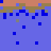 | Standalone tile | 1 × 1 | `FIRSTRIVEDGE` |
| 6 | 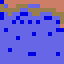 | Standalone tile | 1 × 1 | — |
| 7 | 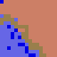 | Standalone tile | 1 × 1 | — |
| 8 | 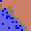 | Standalone tile | 1 × 1 | — |
| 9 | 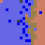 | Standalone tile | 1 × 1 | — |
| 10 | 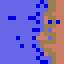 | Standalone tile | 1 × 1 | — |
| 11 |  | Standalone tile | 1 × 1 | — |
| 12 | 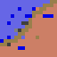 | Standalone tile | 1 × 1 | — |
| 13 | 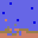 | Standalone tile | 1 × 1 | — |
| 14 | 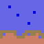 | Standalone tile | 1 × 1 | — |
| 15 |  | Standalone tile | 1 × 1 | — |
| 16 |  | Standalone tile | 1 × 1 | — |
| 17 | 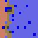 | Standalone tile | 1 × 1 | — |
| 18 |  | Standalone tile | 1 × 1 | — |
| 19 |  | Standalone tile | 1 × 1 | — |
| 20 | 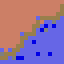 | Standalone tile | 1 × 1 | `LASTRIVEDGE`, `WATER_HIGH` |
| 21 |  | Standalone tile | 1 × 1 | `TREEBASE`, `WOODS_LOW` |
| 22 |  | Standalone tile | 1 × 1 | — |
| 23 | 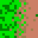 | Standalone tile | 1 × 1 | — |
| 24 |  | Standalone tile | 1 × 1 | — |
| 25 | 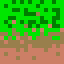 | Standalone tile | 1 × 1 | — |
| 26 | 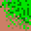 | Standalone tile | 1 × 1 | — |
| 27 | 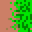 | Standalone tile | 1 × 1 | — |
| 28 |  | Standalone tile | 1 × 1 | — |
| 29 |  | Standalone tile | 1 × 1 | — |
| 30 |  | Standalone tile | 1 × 1 | — |
| 31 | 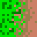 | Standalone tile | 1 × 1 | — |
| 32 |  | Standalone tile | 1 × 1 | — |
| 33 |  | Standalone tile | 1 × 1 | — |
| 34 | 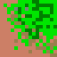 | Standalone tile | 1 × 1 | — |
| 35 | 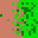 | Standalone tile | 1 × 1 | — |
| 36 |  | Standalone tile | 1 × 1 | `LASTTREE` |
| 37 |  | Standalone tile | 1 × 1 | `WOODS` |
| 38 |  | Standalone tile | 1 × 1 | `UNUSED_TRASH1` |
| 39 |  | Standalone tile | 1 × 1 | `UNUSED_TRASH2`, `WOODS_HIGH` |
| 40 | 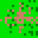 | Standalone tile | 1 × 1 | `WOODS2` |
| 41 | 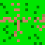 | Standalone tile | 1 × 1 | `WOODS3` |
| 42 | 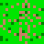 | Standalone tile | 1 × 1 | `WOODS4` |
| 43 | 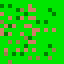 | Standalone tile | 1 × 1 | `WOODS5` |
| 44 | 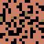 | Standalone tile | 1 × 1 | `RUBBLE` |
| 45 |  | Standalone tile | 1 × 1 | — |
| 46 | 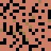 | Standalone tile | 1 × 1 | — |
| 47 |  | Standalone tile | 1 × 1 | `LASTRUBBLE` |
| 48 |  | Standalone tile | 1 × 1 | `FLOOD` |
| 49 |  | Standalone tile | 1 × 1 | — |
| 50 |  | Standalone tile | 1 × 1 | — |
| 51 |  | Standalone tile | 1 × 1 | `LASTFLOOD` |
| 52 | 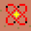 | Standalone tile | 1 × 1 | `RADTILE` |
| 53 | 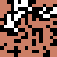 | Standalone tile | 1 × 1 | `UNUSED_TRASH3` |
| 54 |  | Standalone tile | 1 × 1 | `UNUSED_TRASH4` |
| 55 |  | Standalone tile | 1 × 1 | `UNUSED_TRASH5` |
| 56 |  | Standalone tile | 1 × 1 | `FIRE`, `FIREBASE` |
| 57 |  | Standalone tile | 1 × 1 | — |
| 58 |  | Standalone tile | 1 × 1 | — |
| 59 |  | Standalone tile | 1 × 1 | — |
| 60 |  | Standalone tile | 1 × 1 | — |
| 61 |  | Standalone tile | 1 × 1 | — |
| 62 |  | Standalone tile | 1 × 1 | — |
| 63 |  | Standalone tile | 1 × 1 | `LASTFIRE` |
| 64 |  | Standalone tile | 1 × 1 | `HBRIDGE`, `ROADBASE` |
| 65 |  | Standalone tile | 1 × 1 | `VBRIDGE` |
| 66 |  | Standalone tile | 1 × 1 | `ROADS` |
| 67 |  | Standalone tile | 1 × 1 | `ROADS2` |
| 68 |  | Standalone tile | 1 × 1 | `ROADS3` |
| 69 |  | Standalone tile | 1 × 1 | `ROADS4` |
| 70 |  | Standalone tile | 1 × 1 | `ROADS5` |
| 71 |  | Standalone tile | 1 × 1 | `ROADS6` |
| 72 |  | Standalone tile | 1 × 1 | `ROADS7` |
| 73 |  | Standalone tile | 1 × 1 | `ROADS8` |
| 74 |  | Standalone tile | 1 × 1 | `ROADS9` |
| 75 |  | Standalone tile | 1 × 1 | `ROADS10` |
| 76 |  | Standalone tile | 1 × 1 | `INTERSECTION` |
| 77 |  | Standalone tile | 1 × 1 | `HROADPOWER` |
| 78 |  | Standalone tile | 1 × 1 | `VROADPOWER` |
| 79 |  | Standalone tile | 1 × 1 | `BRWH` |
| 80 | 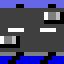 | Standalone tile | 1 × 1 | `LTRFBASE` |
| 81 | 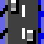 | Standalone tile | 1 × 1 | — |
| 82 |  | Standalone tile | 1 × 1 | — |
| 83 |  | Standalone tile | 1 × 1 | — |
| 84 |  | Standalone tile | 1 × 1 | — |
| 85 |  | Standalone tile | 1 × 1 | — |
| 86 |  | Standalone tile | 1 × 1 | — |
| 87 |  | Standalone tile | 1 × 1 | — |
| 88 |  | Standalone tile | 1 × 1 | — |
| 89 |  | Standalone tile | 1 × 1 | — |
| 90 |  | Standalone tile | 1 × 1 | — |
| 91 |  | Standalone tile | 1 × 1 | — |
| 92 |  | Standalone tile | 1 × 1 | — |
| 93 |  | Standalone tile | 1 × 1 | — |
| 94 |  | Standalone tile | 1 × 1 | — |
| 95 |  | Standalone tile | 1 × 1 | `BRWV` |
| 96 |  | Standalone tile | 1 × 1 | — |
| 97 |  | Standalone tile | 1 × 1 | — |
| 98 |  | Standalone tile | 1 × 1 | — |
| 99 |  | Standalone tile | 1 × 1 | — |
| 100 |  | Standalone tile | 1 × 1 | — |
| 101 |  | Standalone tile | 1 × 1 | — |
| 102 |  | Standalone tile | 1 × 1 | — |
| 103 |  | Standalone tile | 1 × 1 | — |
| 104 |  | Standalone tile | 1 × 1 | — |
| 105 |  | Standalone tile | 1 × 1 | — |
| 106 |  | Standalone tile | 1 × 1 | — |
| 107 |  | Standalone tile | 1 × 1 | — |
| 108 |  | Standalone tile | 1 × 1 | — |
| 109 |  | Standalone tile | 1 × 1 | — |
| 110 |  | Standalone tile | 1 × 1 | — |
| 111 |  | Standalone tile | 1 × 1 | `BRWXXX1` |
| 112 |  | Standalone tile | 1 × 1 | — |
| 113 |  | Standalone tile | 1 × 1 | — |
| 114 |  | Standalone tile | 1 × 1 | — |
| 115 |  | Standalone tile | 1 × 1 | — |
| 116 |  | Standalone tile | 1 × 1 | — |
| 117 |  | Standalone tile | 1 × 1 | — |
| 118 |  | Standalone tile | 1 × 1 | — |
| 119 |  | Standalone tile | 1 × 1 | — |
| 120 |  | Standalone tile | 1 × 1 | — |
| 121 |  | Standalone tile | 1 × 1 | — |
| 122 |  | Standalone tile | 1 × 1 | — |
| 123 |  | Standalone tile | 1 × 1 | — |
| 124 |  | Standalone tile | 1 × 1 | — |
| 125 |  | Standalone tile | 1 × 1 | — |
| 126 | 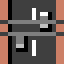 | Standalone tile | 1 × 1 | — |
| 127 |  | Standalone tile | 1 × 1 | `BRWXXX2` |
| 128 |  | Standalone tile | 1 × 1 | — |
| 129 | 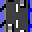 | Standalone tile | 1 × 1 | — |
| 130 |  | Standalone tile | 1 × 1 | — |
| 131 |  | Standalone tile | 1 × 1 | — |
| 132 |  | Standalone tile | 1 × 1 | — |
| 133 |  | Standalone tile | 1 × 1 | — |
| 134 |  | Standalone tile | 1 × 1 | — |
| 135 |  | Standalone tile | 1 × 1 | — |
| 136 |  | Standalone tile | 1 × 1 | — |
| 137 |  | Standalone tile | 1 × 1 | — |
| 138 |  | Standalone tile | 1 × 1 | — |
| 139 |  | Standalone tile | 1 × 1 | — |
| 140 |  | Standalone tile | 1 × 1 | — |
| 141 |  | Standalone tile | 1 × 1 | — |
| 142 |  | Standalone tile | 1 × 1 | — |
| 143 |  | Standalone tile | 1 × 1 | `BRWXXX3` |
| 144 |  | Standalone tile | 1 × 1 | `HTRFBASE` |
| 145 | 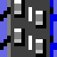 | Standalone tile | 1 × 1 | — |
| 146 |  | Standalone tile | 1 × 1 | — |
| 147 |  | Standalone tile | 1 × 1 | — |
| 148 |  | Standalone tile | 1 × 1 | — |
| 149 |  | Standalone tile | 1 × 1 | — |
| 150 |  | Standalone tile | 1 × 1 | — |
| 151 |  | Standalone tile | 1 × 1 | — |
| 152 |  | Standalone tile | 1 × 1 | — |
| 153 |  | Standalone tile | 1 × 1 | — |
| 154 |  | Standalone tile | 1 × 1 | — |
| 155 |  | Standalone tile | 1 × 1 | — |
| 156 |  | Standalone tile | 1 × 1 | — |
| 157 |  | Standalone tile | 1 × 1 | — |
| 158 | 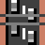 | Standalone tile | 1 × 1 | — |
| 159 |  | Standalone tile | 1 × 1 | `BRWXXX4` |
| 160 |  | Standalone tile | 1 × 1 | — |
| 161 |  | Standalone tile | 1 × 1 | — |
| 162 |  | Standalone tile | 1 × 1 | — |
| 163 |  | Standalone tile | 1 × 1 | — |
| 164 |  | Standalone tile | 1 × 1 | — |
| 165 |  | Standalone tile | 1 × 1 | — |
| 166 |  | Standalone tile | 1 × 1 | — |
| 167 |  | Standalone tile | 1 × 1 | — |
| 168 |  | Standalone tile | 1 × 1 | — |
| 169 |  | Standalone tile | 1 × 1 | — |
| 170 |  | Standalone tile | 1 × 1 | — |
| 171 |  | Standalone tile | 1 × 1 | — |
| 172 |  | Standalone tile | 1 × 1 | — |
| 173 |  | Standalone tile | 1 × 1 | — |
| 174 |  | Standalone tile | 1 × 1 | — |
| 175 |  | Standalone tile | 1 × 1 | `BRWXXX5` |
| 176 | 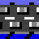 | Standalone tile | 1 × 1 | — |
| 177 | 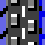 | Standalone tile | 1 × 1 | — |
| 178 | 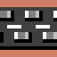 | Standalone tile | 1 × 1 | — |
| 179 |  | Standalone tile | 1 × 1 | — |
| 180 |  | Standalone tile | 1 × 1 | — |
| 181 |  | Standalone tile | 1 × 1 | — |
| 182 |  | Standalone tile | 1 × 1 | — |
| 183 |  | Standalone tile | 1 × 1 | — |
| 184 |  | Standalone tile | 1 × 1 | — |
| 185 | 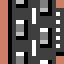 | Standalone tile | 1 × 1 | — |
| 186 |  | Standalone tile | 1 × 1 | — |
| 187 | 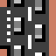 | Standalone tile | 1 × 1 | — |
| 188 | 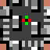 | Standalone tile | 1 × 1 | — |
| 189 |  | Standalone tile | 1 × 1 | — |
| 190 | 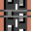 | Standalone tile | 1 × 1 | — |
| 191 |  | Standalone tile | 1 × 1 | `BRWXXX6` |
| 192 | 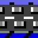 | Standalone tile | 1 × 1 | — |
| 193 | 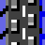 | Standalone tile | 1 × 1 | — |
| 194 |  | Standalone tile | 1 × 1 | — |
| 195 |  | Standalone tile | 1 × 1 | — |
| 196 |  | Standalone tile | 1 × 1 | — |
| 197 |  | Standalone tile | 1 × 1 | — |
| 198 |  | Standalone tile | 1 × 1 | — |
| 199 |  | Standalone tile | 1 × 1 | — |
| 200 |  | Standalone tile | 1 × 1 | — |
| 201 | 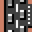 | Standalone tile | 1 × 1 | — |
| 202 |  | Standalone tile | 1 × 1 | — |
| 203 | 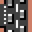 | Standalone tile | 1 × 1 | — |
| 204 |  | Standalone tile | 1 × 1 | — |
| 205 |  | Standalone tile | 1 × 1 | — |
| 206 | 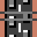 | Standalone tile | 1 × 1 | `LASTROAD` |
| 207 |  | Standalone tile | 1 × 1 | `BRWXXX7` |
| 208 | 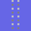 | Standalone tile | 1 × 1 | `HPOWER`, `POWERBASE` |
| 209 |  | Standalone tile | 1 × 1 | `VPOWER` |
| 210 | 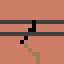 | Standalone tile | 1 × 1 | `LHPOWER` |
| 211 | 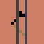 | Standalone tile | 1 × 1 | `LVPOWER` |
| 212 |  | Standalone tile | 1 × 1 | `LVPOWER2` |
| 213 |  | Standalone tile | 1 × 1 | `LVPOWER3` |
| 214 | 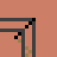 | Standalone tile | 1 × 1 | `LVPOWER4` |
| 215 |  | Standalone tile | 1 × 1 | `LVPOWER5` |
| 216 | 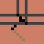 | Standalone tile | 1 × 1 | `LVPOWER6` |
| 217 | 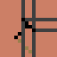 | Standalone tile | 1 × 1 | `LVPOWER7` |
| 218 |  | Standalone tile | 1 × 1 | `LVPOWER8` |
| 219 |  | Standalone tile | 1 × 1 | `LVPOWER9` |
| 220 |  | Standalone tile | 1 × 1 | `LVPOWER10` |
| 221 |  | Standalone tile | 1 × 1 | `RAILHPOWERV` |
| 222 |  | Standalone tile | 1 × 1 | `RAILVPOWERH`, `LASTPOWER` |
| 223 |  | Standalone tile | 1 × 1 | `UNUSED_TRASH6` |
| 224 |  | Standalone tile | 1 × 1 | `HRAIL`, `RAILBASE` |
| 225 |  | Standalone tile | 1 × 1 | `VRAIL` |
| 226 |  | Standalone tile | 1 × 1 | `LHRAIL` |
| 227 |  | Standalone tile | 1 × 1 | `LVRAIL` |
| 228 |  | Standalone tile | 1 × 1 | `LVRAIL2` |
| 229 |  | Standalone tile | 1 × 1 | `LVRAIL3` |
| 230 |  | Standalone tile | 1 × 1 | `LVRAIL4` |
| 231 |  | Standalone tile | 1 × 1 | `LVRAIL5` |
| 232 |  | Standalone tile | 1 × 1 | `LVRAIL6` |
| 233 |  | Standalone tile | 1 × 1 | `LVRAIL7` |
| 234 |  | Standalone tile | 1 × 1 | `LVRAIL8` |
| 235 |  | Standalone tile | 1 × 1 | `LVRAIL9` |
| 236 |  | Standalone tile | 1 × 1 | `LVRAIL10` |
| 237 |  | Standalone tile | 1 × 1 | `HRAILROAD` |
| 238 |  | Standalone tile | 1 × 1 | `VRAILROAD`, `LASTRAIL` |
| 239 |  | Standalone tile | 1 × 1 | `ROADVPOWERH` |
| 240–248 |  | Empty residential zone | 3 × 3 | `RESBASE`, `FREEZ` |
| 249 |  | Standalone tile | 1 × 1 | `HOUSE`, `LHTHR` |
| 250 |  | Standalone tile | 1 × 1 | — |
| 251 |  | Standalone tile | 1 × 1 | — |
| 252 |  | Standalone tile | 1 × 1 | — |
| 253 |  | Standalone tile | 1 × 1 | — |
| 254 |  | Standalone tile | 1 × 1 | — |
| 255 |  | Standalone tile | 1 × 1 | — |
| 256 |  | Standalone tile | 1 × 1 | — |
| 257 |  | Standalone tile | 1 × 1 | — |
| 258 |  | Standalone tile | 1 × 1 | — |
| 259 |  | Standalone tile | 1 × 1 | — |
| 260 |  | Standalone tile | 1 × 1 | `HHTHR` |
| 261–269 |  | Residential — value tier 1, density level 1 | 3 × 3 | `RZB` |
| 270–278 |  | Residential — value tier 1, density level 2 | 3 × 3 | — |
| 279–287 |  | Residential — value tier 1, density level 3 | 3 × 3 | — |
| 288–296 |  | Residential — value tier 1, density level 4 | 3 × 3 | — |
| 297–305 |  | Residential — value tier 2, density level 1 | 3 × 3 | — |
| 306–314 |  | Residential — value tier 2, density level 2 | 3 × 3 | — |
| 315–323 |  | Residential — value tier 2, density level 3 | 3 × 3 | — |
| 324–332 |  | Residential — value tier 2, density level 4 | 3 × 3 | — |
| 333–341 |  | Residential — value tier 3, density level 1 | 3 × 3 | — |
| 342–350 |  | Residential — value tier 3, density level 2 | 3 × 3 | — |
| 351–359 |  | Residential — value tier 3, density level 3 | 3 × 3 | — |
| 360–368 |  | Residential — value tier 3, density level 4 | 3 × 3 | — |
| 369–377 |  | Residential — value tier 4, density level 1 | 3 × 3 | — |
| 378–386 |  | Residential — value tier 4, density level 2 | 3 × 3 | — |
| 387–395 |  | Residential — value tier 4, density level 3 | 3 × 3 | — |
| 396–404 |  | Residential — value tier 4, density level 4 | 3 × 3 | — |
| 405–413 |  | Hospital | 3 × 3 | `HOSPITALBASE`, `HOSPITAL` |
| 414–422 |  | Church — original | 3 × 3 | `CHURCHBASE`, `CHURCH0BASE`, `CHURCH`, `CHURCH0` |
| 423–431 |  | Empty commercial zone | 3 × 3 | `COMBASE`, `COMCLR` |
| 432–440 |  | Commercial — value tier 1, density level 1 | 3 × 3 | `CZB` |
| 441–449 |  | Commercial — value tier 1, density level 2 | 3 × 3 | — |
| 450–458 |  | Commercial — value tier 1, density level 3 | 3 × 3 | — |
| 459–467 |  | Commercial — value tier 1, density level 4 | 3 × 3 | — |
| 468–476 |  | Commercial — value tier 1, density level 5 | 3 × 3 | — |
| 477–485 |  | Commercial — value tier 2, density level 1 | 3 × 3 | — |
| 486–494 |  | Commercial — value tier 2, density level 2 | 3 × 3 | — |
| 495–503 |  | Commercial — value tier 2, density level 3 | 3 × 3 | — |
| 504–512 |  | Commercial — value tier 2, density level 4 | 3 × 3 | — |
| 513–521 |  | Commercial — value tier 2, density level 5 | 3 × 3 | — |
| 522–530 |  | Commercial — value tier 3, density level 1 | 3 × 3 | — |
| 531–539 |  | Commercial — value tier 3, density level 2 | 3 × 3 | — |
| 540–548 |  | Commercial — value tier 3, density level 3 | 3 × 3 | — |
| 549–557 |  | Commercial — value tier 3, density level 4 | 3 × 3 | — |
| 558–566 |  | Commercial — value tier 3, density level 5 | 3 × 3 | — |
| 567–575 |  | Commercial — value tier 4, density level 1 | 3 × 3 | — |
| 576–584 |  | Commercial — value tier 4, density level 2 | 3 × 3 | — |
| 585–593 |  | Commercial — value tier 4, density level 3 | 3 × 3 | — |
| 594–602 |  | Commercial — value tier 4, density level 4 | 3 × 3 | — |
| 603–611 |  | Commercial — value tier 4, density level 5 | 3 × 3 | `COMLAST` |
| 612–620 |  | Empty industrial zone | 3 × 3 | `INDBASE`, `INDCLR`, `LASTIND` |
| 621–629 |  | Industrial — value tier 1, density level 1 | 3 × 3 | `IND1`, `IZB` |
| 630–638 |  | Industrial — value tier 1, density level 2 | 3 × 3 | — |
| 639–647 |  | Industrial — value tier 1, density level 3 | 3 × 3 | `IND2`, `IND3` |
| 648–656 |  | Industrial — value tier 1, density level 4 | 3 × 3 | `IND4`, `IND5` |
| 657–665 |  | Industrial — value tier 2, density level 1 | 3 × 3 | — |
| 666–674 |  | Industrial — value tier 2, density level 2 | 3 × 3 | — |
| 675–683 |  | Industrial — value tier 2, density level 3 | 3 × 3 | `IND6`, `IND7` |
| 684–692 |  | Industrial — value tier 2, density level 4 | 3 × 3 | `IND8`, `IND9` |
| 693–708 |  | Seaport | 4 × 4 | `PORTBASE`, `PORT`, `LASTPORT` |
| 709–744 |  | Airport | 6 × 6 | `AIRPORTBASE`, `RADAR`, `AIRPORT` |
| 745–760 |  | Coal power plant | 4 × 4 | `COALBASE`, `POWERPLANT`, `LASTPOWERPLANT` |
| 761–769 |  | Fire station | 3 × 3 | `FIRESTBASE`, `FIRESTATION` |
| 770–778 |  | Police station | 3 × 3 | `POLICESTBASE`, `POLICESTATION` |
| 779–794 |  | Stadium — empty | 4 × 4 | `STADIUMBASE`, `STADIUM` |
| 795–810 |  | Stadium — game in progress | 4 × 4 | `FULLSTADIUM` |
| 811–826 |  | Nuclear power plant | 4 × 4 | `NUCLEARBASE`, `NUCLEAR`, `LASTZONE` |
| 827 |  | Standalone tile | 1 × 1 | `LIGHTNINGBOLT` |
| 828 |  | Standalone tile | 1 × 1 | `HBRDG0` |
| 829 |  | Standalone tile | 1 × 1 | `HBRDG1` |
| 830 |  | Standalone tile | 1 × 1 | `HBRDG2` |
| 831 |  | Standalone tile | 1 × 1 | `HBRDG3` |
| 832 |  | Standalone tile | 1 × 1 | `HBRDG_END`, `RADAR0` |
| 833 |  | Standalone tile | 1 × 1 | `RADAR1` |
| 834 |  | Standalone tile | 1 × 1 | `RADAR2` |
| 835 |  | Standalone tile | 1 × 1 | `RADAR3` |
| 836 |  | Standalone tile | 1 × 1 | `RADAR4` |
| 837 |  | Standalone tile | 1 × 1 | `RADAR5` |
| 838 |  | Standalone tile | 1 × 1 | `RADAR6` |
| 839 |  | Standalone tile | 1 × 1 | `RADAR7` |
| 840 |  | Standalone tile | 1 × 1 | `FOUNTAIN` |
| 841 |  | Standalone tile | 1 × 1 | — |
| 842 |  | Standalone tile | 1 × 1 | — |
| 843 |  | Standalone tile | 1 × 1 | — |
| 844 |  | Standalone tile | 1 × 1 | `INDBASE2`, `TELEBASE` |
| 845 |  | Standalone tile | 1 × 1 | — |
| 846 |  | Standalone tile | 1 × 1 | — |
| 847 |  | Standalone tile | 1 × 1 | — |
| 848 |  | Standalone tile | 1 × 1 | — |
| 849 |  | Standalone tile | 1 × 1 | — |
| 850 |  | Standalone tile | 1 × 1 | — |
| 851 |  | Standalone tile | 1 × 1 | `TELELAST` |
| 852 |  | Standalone tile | 1 × 1 | `SMOKEBASE` |
| 853 |  | Standalone tile | 1 × 1 | — |
| 854 |  | Standalone tile | 1 × 1 | — |
| 855 |  | Standalone tile | 1 × 1 | — |
| 856 |  | Standalone tile | 1 × 1 | — |
| 857 |  | Standalone tile | 1 × 1 | — |
| 858 |  | Standalone tile | 1 × 1 | — |
| 859 |  | Standalone tile | 1 × 1 | — |
| 860 |  | Standalone tile | 1 × 1 | `TINYEXP` |
| 861 |  | Standalone tile | 1 × 1 | — |
| 862 |  | Standalone tile | 1 × 1 | — |
| 863 |  | Standalone tile | 1 × 1 | — |
| 864 |  | Standalone tile | 1 × 1 | `SOMETINYEXP` |
| 865 |  | Standalone tile | 1 × 1 | — |
| 866 |  | Standalone tile | 1 × 1 | — |
| 867 |  | Standalone tile | 1 × 1 | `LASTTINYEXP` |
| 868 |  | Standalone tile | 1 × 1 | — |
| 869 |  | Standalone tile | 1 × 1 | — |
| 870 |  | Standalone tile | 1 × 1 | — |
| 871 |  | Standalone tile | 1 × 1 | — |
| 872 |  | Standalone tile | 1 × 1 | — |
| 873 |  | Standalone tile | 1 × 1 | — |
| 874 |  | Standalone tile | 1 × 1 | — |
| 875 |  | Standalone tile | 1 × 1 | — |
| 876 |  | Standalone tile | 1 × 1 | — |
| 877 |  | Standalone tile | 1 × 1 | — |
| 878 |  | Standalone tile | 1 × 1 | — |
| 879 |  | Standalone tile | 1 × 1 | — |
| 880 |  | Standalone tile | 1 × 1 | — |
| 881 |  | Standalone tile | 1 × 1 | — |
| 882 |  | Standalone tile | 1 × 1 | — |
| 883 |  | Standalone tile | 1 × 1 | `TINYEXPLAST` |
| 884 |  | Standalone tile | 1 × 1 | — |
| 885 |  | Standalone tile | 1 × 1 | — |
| 886 |  | Standalone tile | 1 × 1 | — |
| 887 |  | Standalone tile | 1 × 1 | — |
| 888 |  | Standalone tile | 1 × 1 | — |
| 889 |  | Standalone tile | 1 × 1 | — |
| 890 |  | Standalone tile | 1 × 1 | — |
| 891 |  | Standalone tile | 1 × 1 | — |
| 892 |  | Standalone tile | 1 × 1 | — |
| 893 |  | Standalone tile | 1 × 1 | — |
| 894 |  | Standalone tile | 1 × 1 | — |
| 895 |  | Standalone tile | 1 × 1 | — |
| 896 |  | Standalone tile | 1 × 1 | — |
| 897 |  | Standalone tile | 1 × 1 | — |
| 898 |  | Standalone tile | 1 × 1 | — |
| 899 |  | Standalone tile | 1 × 1 | — |
| 900 |  | Standalone tile | 1 × 1 | — |
| 901 |  | Standalone tile | 1 × 1 | — |
| 902 |  | Standalone tile | 1 × 1 | — |
| 903 |  | Standalone tile | 1 × 1 | — |
| 904 |  | Standalone tile | 1 × 1 | — |
| 905 |  | Standalone tile | 1 × 1 | — |
| 906 |  | Standalone tile | 1 × 1 | — |
| 907 |  | Standalone tile | 1 × 1 | — |
| 908 |  | Standalone tile | 1 × 1 | — |
| 909 |  | Standalone tile | 1 × 1 | — |
| 910 |  | Standalone tile | 1 × 1 | — |
| 911 |  | Standalone tile | 1 × 1 | — |
| 912 |  | Standalone tile | 1 × 1 | — |
| 913 |  | Standalone tile | 1 × 1 | — |
| 914 |  | Standalone tile | 1 × 1 | — |
| 915 |  | Standalone tile | 1 × 1 | — |
| 916 |  | Standalone tile | 1 × 1 | `COALSMOKE1` |
| 917 |  | Standalone tile | 1 × 1 | — |
| 918 |  | Standalone tile | 1 × 1 | — |
| 919 |  | Standalone tile | 1 × 1 | — |
| 920 |  | Standalone tile | 1 × 1 | `COALSMOKE2` |
| 921 |  | Standalone tile | 1 × 1 | — |
| 922 |  | Standalone tile | 1 × 1 | — |
| 923 |  | Standalone tile | 1 × 1 | — |
| 924 |  | Standalone tile | 1 × 1 | `COALSMOKE3` |
| 925 |  | Standalone tile | 1 × 1 | — |
| 926 |  | Standalone tile | 1 × 1 | — |
| 927 |  | Standalone tile | 1 × 1 | — |
| 928 |  | Standalone tile | 1 × 1 | `COALSMOKE4` |
| 929 |  | Standalone tile | 1 × 1 | — |
| 930 |  | Standalone tile | 1 × 1 | — |
| 931 |  | Standalone tile | 1 × 1 | — |
| 932 |  | Standalone tile | 1 × 1 | `FOOTBALLGAME1` |
| 933 |  | Standalone tile | 1 × 1 | — |
| 934 |  | Standalone tile | 1 × 1 | — |
| 935 |  | Standalone tile | 1 × 1 | — |
| 936 |  | Standalone tile | 1 × 1 | — |
| 937 |  | Standalone tile | 1 × 1 | — |
| 938 |  | Standalone tile | 1 × 1 | — |
| 939 |  | Standalone tile | 1 × 1 | — |
| 940 |  | Standalone tile | 1 × 1 | `FOOTBALLGAME2` |
| 941 |  | Standalone tile | 1 × 1 | — |
| 942 |  | Standalone tile | 1 × 1 | — |
| 943 |  | Standalone tile | 1 × 1 | — |
| 944 |  | Standalone tile | 1 × 1 | — |
| 945 |  | Standalone tile | 1 × 1 | — |
| 946 |  | Standalone tile | 1 × 1 | — |
| 947 |  | Standalone tile | 1 × 1 | — |
| 948 |  | Standalone tile | 1 × 1 | `VBRDG0` |
| 949 |  | Standalone tile | 1 × 1 | `VBRDG1` |
| 950 |  | Standalone tile | 1 × 1 | `VBRDG2` |
| 951 |  | Standalone tile | 1 × 1 | `VBRDG3` |
| 952 |  | Standalone tile | 1 × 1 | `NUKESWIRL1` |
| 953 |  | Standalone tile | 1 × 1 | `NUKESWIRL2` |
| 954 |  | Standalone tile | 1 × 1 | `NUKESWIRL3` |
| 955 |  | Standalone tile | 1 × 1 | `NUKESWIRL4` |
| 956–964 |  | Church — variant 1 | 3 × 3 | `CHURCH1BASE`, `CHURCH1` |
| 965–973 |  | Church — variant 2 | 3 × 3 | `CHURCH2BASE`, `CHURCH2` |
| 974–982 |  | Church — variant 3 | 3 × 3 | `CHURCH3BASE`, `CHURCH3` |
| 983–991 |  | Church — variant 4 | 3 × 3 | `CHURCH4BASE`, `CHURCH4` |
| 992–1000 |  | Church — variant 5 | 3 × 3 | `CHURCH5BASE`, `CHURCH5` |
| 1001–1009 |  | Church — variant 6 | 3 × 3 | `CHURCH6BASE`, `CHURCH6` |
| 1010–1018 |  | Church — variant 7 | 3 × 3 | `CHURCH7BASE`, `CHURCH7`, `CHURCH7LAST` |
| 1019 |  | Standalone tile | 1 × 1 | — |
| 1020 |  | Standalone tile | 1 × 1 | — |
| 1021 |  | Standalone tile | 1 × 1 | — |
| 1022 |  | Standalone tile | 1 × 1 | — |
| 1023 |  | Standalone tile | 1 × 1 | — |
